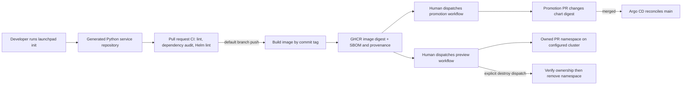

# Architecture and security boundaries

## Delivery flow

The promotion and preview workflows run from the default branch only. Pull-request CI never deploys, uses `pull_request_target`, or checks out a pull-request head with deployment credentials. Preview deployment is not automatic: a maintainer dispatches it with a published digest and a positive PR number. The preview uses the trusted default-branch chart and service image identified by that digest.

## Components

- The CLI supports Python 3.12 and uses only the standard library at runtime. Its `init`, `check`, `render`, `preview-plan`, and `destroy-plan` commands are registered in `src/launchpad/cli.py`.
- The generated service uses `http.server`, responds on port 8000, and exposes health, readiness, and request-count metrics endpoints. It has no external runtime packages.
- The container uses `python:3.12.14-slim`, runs as UID/GID 10001, and has no shell-form command.
- The Helm chart pins images by `repository@sha256:digest`; an empty digest makes template rendering fail. The values schema allows an empty initial value so a freshly scaffolded repository can exist before its first image is built.
- The Argo CD `Application` reads the chart's committed values. It supplies no inline digest override, so a merged promotion PR is the source of the deployed image change.
- The generated service CI runs linting, dependency auditing, and Helm chart validation for pull requests and pushes to `main`. On a push to `main`, after validation, it publishes a commit tag to GHCR, requests BuildKit provenance and an SBOM, and publishes an attestation for the resulting digest.
- The platform CI runs Ruff and bytecode compilation on its Python source, audits dependencies, scaffolds a temporary service and checks its required files, then runs `helm lint` and `launchpad render` on the generated chart. Both chart commands use a synthetic digest derived from `Chart.yaml` only to permit rendering; it is not an image and is never pushed or promoted.

## Workload controls

The chart creates a Deployment, ClusterIP Service, ServiceAccount, ResourceQuota, PodDisruptionBudget, and NetworkPolicy. Workload pods run as non-root, disable service-account token mounting, use the runtime-default seccomp profile, drop all Linux capabilities, disallow privilege escalation, and mount a size-limited `/tmp` over a read-only root filesystem. CPU and memory requests and limits are set in `values.yaml`; replica count defaults to two.

The sample has no external service dependencies, so the NetworkPolicy denies all egress. It allows inbound TCP 8000 only from pods labeled `launchpad.dev/access` with the generated service name in the same namespace. A service that calls upstream APIs, DNS, databases, or telemetry endpoints must add narrowly scoped egress policy before use.

The chart creates a ClusterIP Service but no Ingress or Gateway resource. The default policy therefore keeps the service private; add an ingress path and narrow ingress policy for your cluster's ingress controller before exposing it.

## Trust and cleanup boundaries

- Scaffold inputs are validated before writing. Output paths reject `..`, symbolic-link traversal, and overwrite. Templates are fixed package assets; user input only fills three validated markers.
- Helm receives an argv list, not a shell command string. CLI render and plan commands do not perform cluster calls.
- Preview workflow dispatch is restricted to the default branch and GitHub `preview` environment. Configure required reviewers on that environment and store `KUBECONFIG_B64` there. Use an isolated preview cluster and a dedicated credential with only the access needed to create, inspect, deploy into, and remove preview namespaces.
- Preview namespaces use a derived name `preview-{service[:28]}-{repo_hash[:8]}-pr-{number}`. The PR must be numeric and positive. The namespace receives ownership labels and a full-repository annotation. Before reusing or deleting an existing namespace, the script checks the expected namespace name, labels, and annotation. A name collision with a namespace owned by someone else fails closed.
- A failed Helm deployment may leave its owned namespace for inspection. Cleanup is a separate explicit `destroy` workflow dispatch; there is no automatic cleanup step that could erase a preview after a failed deploy.
- The chart does not define `imagePullSecrets`. Ensure the cluster can read the GHCR package, for example with an approved cluster-level registry credential mechanism. Private Argo CD source repositories also need credentials configured in Argo CD.

This repository contains no Terraform, cloud credentials, or cloud provisioning. The preview cluster is external and may incur cost according to its owner; this repository does not provision it.
